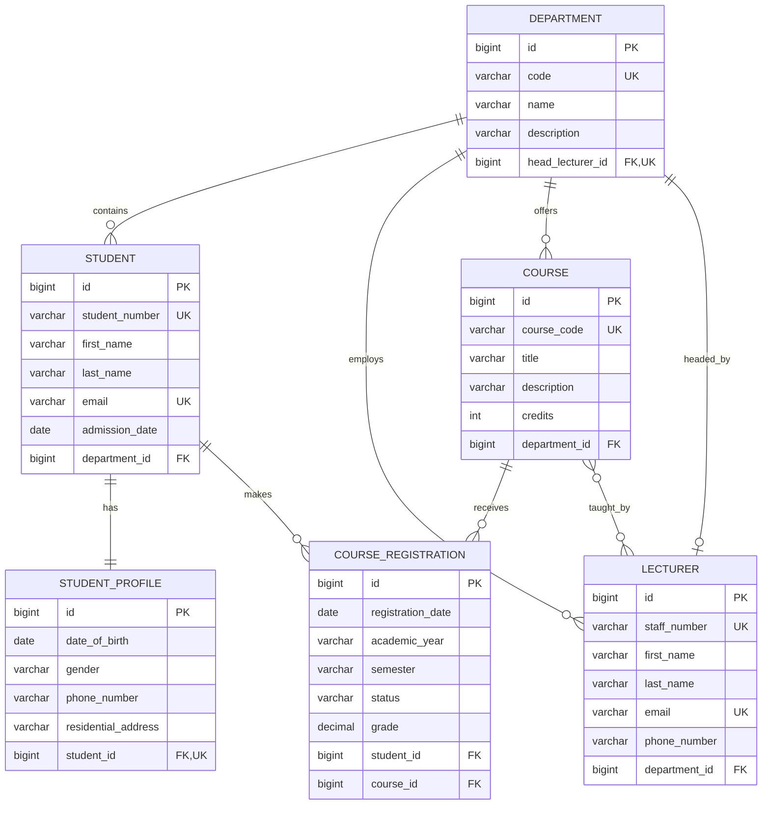

# Entity Relationship Diagram (ERD)

The following Mermaid ER diagram can be previewed in VS Code with a Mermaid extension or in a Markdown viewer that supports Mermaid.

**Physical join table:** `course_lecturers(course_id, lecturer_id)` implements the Lecturer-Course many-to-many association. It is not a Java entity, as requested.

**Join entity:** `course_registrations` is a Java entity and a database table because the Student-Course association carries registration data.
